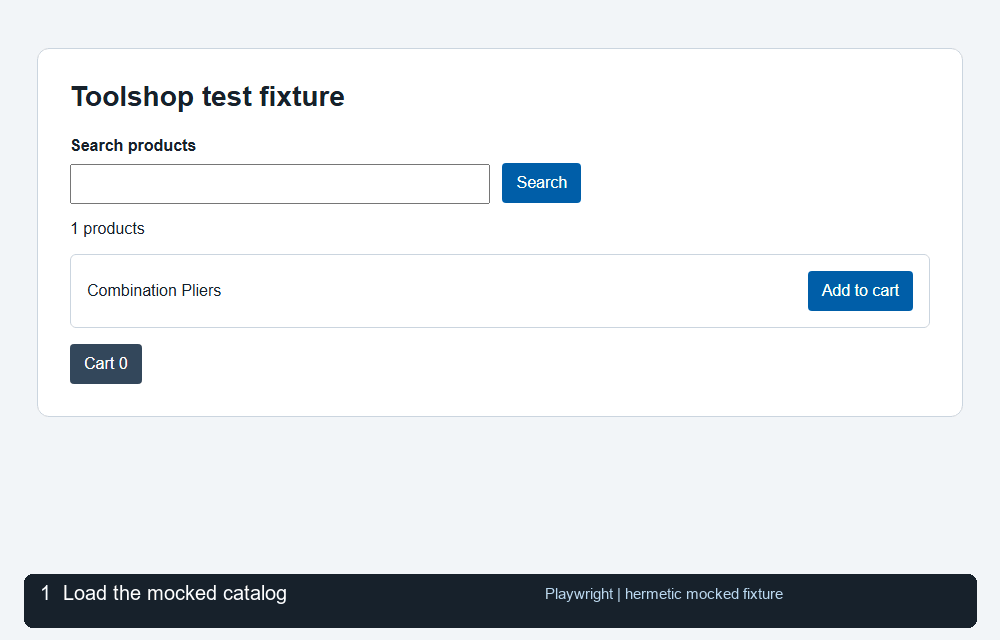
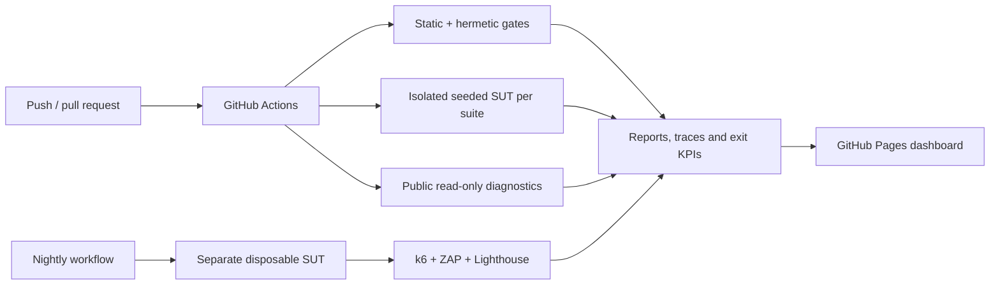

# Toolshop Hybrid Automation

[](https://github.com/CarlosG-G/Toolshop-Hybrid-Automation/actions/workflows/ci.yml)
[](https://github.com/CarlosG-G/Toolshop-Hybrid-Automation/actions/workflows/nightly-quality.yml)
[](https://github.com/CarlosG-G/Toolshop-Hybrid-Automation/actions/workflows/codeql.yml)

**A risk-based test automation portfolio:** Playwright, Vibium and BDD against
[Practice Software Testing Toolshop](https://practicesoftwaretesting.com), with
test management and evidence organized using ISTQB terminology.

[Explore the dashboard](https://carlosg-g.github.io/Toolshop-Hybrid-Automation/) |
[Test strategy and plan](docs/test-management/test-strategy.md) |
[Requirement traceability](docs/test-management/traceability-matrix.md) |
[Defect log](docs/test-management/defect-log.md)

Writes, load and security scans run **only against a disposable loopback SUT**.
Public-site checks are read-only and informational, not the regression gate.



_The animation is a real Playwright execution against the local mocked fixture;
it is not a recording of the live Toolshop SUT._

## Architecture



## Why both tools?

- **Playwright** is the regression gate: API reads, hermetic network mocking,
  accessible UI locators, traces, and axe accessibility checks.
- **Vibium** adds a focused semantic smoke using WebDriver BiDi and role/text
  locators.
- The **hybrid flow** searches for a product with Playwright, passes its detail
  URL to a separate Vibium browser, and verifies the product heading.
- The intentional-bugs target treats the known missing accessible heading as an
  expected defect (`WB-01`). The report counts those observations as detected,
  separately from unexpected failures.
- Vibium MCP can expose browser controls to a separately configured AI client;
  CI does not invoke an LLM or execute generated code.

See [ADR 001](docs/adr/001-tool-selection.md) for the trade-offs.

## Requirements

- Node.js 22.19 or later, with npm
- Playwright Chromium for the local regression suite
- Vibium Chrome for Vibium tests

## Quick start

```bash
npm ci
npx playwright install chromium
npx vibium install
npm run typecheck
npm run lint
npm run format:check
npm run traceability
npm run test:hermetic
npm run test:hybrid:hermetic
```

Hermetic tests run against a local fixture and deterministic mocked API. They
do not depend on Toolshop being available. Both the Playwright gate and the
separate Playwright/Vibium hybrid smoke are required in CI. CI retains traces,
screenshots and reports as artifacts.

## Live tests

Live tests are read-only by default. They do not register users, submit orders,
or create persistent data in the shared demo environment.

```bash
npm run healthcheck
npm run test:stable
npm run test:with-bugs
```

The workflow health-gates public API and UI suites independently. A public
health or test failure is shown in the report but does not hide a failure in
the required hermetic or disposable-SUT suites.

Some hosted runners receive HTTP 403 from the public site. The report marks the
affected site's check as unavailable and skips its live checks; the hermetic
hybrid smoke and disposable-SUT tests still run. Run live tests locally where
access is allowed or use an authorized compatible deployment.

The `stable` and `with-bugs` targets can also be selected with
`TOOLSHOP_TARGET`. Live tests use the public catalog only; do not add write
operations without an explicit disposable-data and cleanup strategy.

Set `TOOLSHOP_SITE_URL` and `TOOLSHOP_API_URL` to use another compatible
environment for both health checks and tests. Invalid target names fail
explicitly. Write tests require the `local` target **and** loopback URLs for
both the UI and API, including when either URL is overridden.

## Test suites

| Suite                            | Tools               | Scope and CI behavior                                                   |
| -------------------------------- | ------------------- | ----------------------------------------------------------------------- |
| `tests/unit`, `tests/mocked`     | Playwright          | Required hermetic tests and deterministic network mocks                 |
| `tests/hermetic`                 | Playwright + Vibium | Required hybrid check on a local fixture                                |
| `tests/api`, `tests/contract`    | Playwright + Ajv    | Required API and OpenAPI regression on the disposable SUT               |
| `tests/e2e`                      | Playwright          | Required registration, checkout and payment journeys                    |
| `tests/features`                 | Playwright BDD      | Required Gherkin registration, checkout and invalid-payment scenarios   |
| `tests/visual/sut.spec.ts`       | Playwright          | Required Linux login-form visual baseline in a pinned browser container |
| `tests/vibium/local.spec.ts`     | Vibium              | Independent required login, cart and negative-login checks on the SUT   |
| `tests/security`                 | Playwright          | Required API authorization, JWT, injection and data-exposure checks     |
| `tests/nonfunctional`            | Playwright + axe    | Required accessibility, budgets, responsive and resilience checks       |
| `tests/vibium`, `tests/hybrid`   | Vibium + Playwright | Public smoke diagnostics are informational                              |
| `tests/load`, ZAP and Lighthouse | k6, ZAP, Lighthouse | Scheduled checks on a separate disposable SUT                           |

`tests/mocked` also runs axe-core against the deterministic fixture. Playwright
traces, screenshots, and HTML reports are retained as CI artifacts.

The [checkout E2E matrix](tests/e2e/checkout.spec.ts) covers bank transfer, cash on
delivery, credit card, buy-now-pay-later, and gift card (`TC-E2E-010` to `TC-E2E-014`).
Each case starts with a fresh browser/cart, checks payment, confirms the order,
and verifies that the UI displays the invoice number returned by the API.
Checkout observes postcode lookups after the UI's 300 ms debounce, waits for all
matching requests and verifies that the billing fields reflect the final response
before advancing. Timeouts, HTTP and network errors, and incomplete results fail
explicitly. This synchronization depends on the SUT's lookup behavior.
Writes are restricted to `TOOLSHOP_TARGET=local`; no public demo accounts are modified.

### Test types and design techniques

| Type                          | Where                                                        | ISTQB technique / standard                         |
| ----------------------------- | ------------------------------------------------------------ | -------------------------------------------------- |
| Unit and mocked integration   | `tests/unit`, `tests/mocked`                                 | Component tests, controlled doubles                |
| Positive functional (API, UI) | `tests/api`, `tests/e2e`                                     | Use-case testing, data-driven equivalence classes  |
| Negative and validation       | `tests/api/robustness.spec.ts`, `tests/e2e/negative.spec.ts` | Equivalence partitioning, BVA, error guessing      |
| Payment rule partitions       | `src/data/payments.ts` (shared by API and UI)                | Invalid partitions per field, client/server parity |
| Contract                      | `tests/contract`                                             | OpenAPI schema validation                          |
| BDD                           | `tests/features`                                             | Scenarios and outlines using shared page objects   |
| Security                      | `tests/security`                                             | OWASP API Security Top 10                          |
| Accessibility                 | `tests/nonfunctional/accessibility.spec.ts`                  | WCAG 2.1 AA with axe-core                          |
| Performance                   | `tests/nonfunctional/performance.spec.ts`                    | p95 latency budget, concurrency smoke              |
| Mobile / responsive           | `tests/nonfunctional/responsive.spec.ts`                     | Viewport overflow and navigation usability         |
| Resilience                    | `tests/nonfunctional/resilience.spec.ts`                     | Fault injection (latency, 5xx, connection refused) |
| Visual                        | `tests/visual`                                               | Platform-specific pixel comparison                 |
| Hybrid browser verification   | `tests/hermetic`, `tests/vibium`, `tests/hybrid`             | Independent Playwright and Vibium observations     |
| Load and DAST                 | `tests/load`, `.github/workflows/nightly-quality.yml`        | k6 thresholds and ZAP baseline scan                |

Defects found by these suites are tracked in the [defect log](docs/test-management/defect-log.md);
their detecting tests use `test.fail()` so the pipeline turns red as soon as behaviour changes.

With Docker Compose available, run the same suite locally:

```bash
npm run sut:up
npm run test:local -- tests/e2e
npm run bdd:generate
npm run test:local -- --project=bdd
npm run sut:down
```

Docker is not required on your workstation when running the workflow in GitHub Actions.

## Test management and evidence

The [strategy and master plan](docs/test-management/test-strategy.md) define
scope, entry/exit criteria, risk scoring and design techniques. Requirements and
case IDs are checked by `npm run traceability`; the
[generated matrix](docs/test-management/traceability-matrix.md) also links
recorded defects. BDD features reuse page objects and the checkout helper.

Each run can produce a JSON/Markdown exit report and a dashboard with results
by test type, open defects, flaky cases, missing reports and recent runs:

The nightly dashboard compares both public targets and both independent local
SUT matrices. `local-from-stable` and `local-from-with-bugs` identify the
workflow that ran each disposable SUT, not different public deployments.
Totals count executions, including browser projects, rather than unique
designed cases. Project names identify the browser when Playwright reports it.

- **Pass rate** = passed / executed; skipped cases are excluded. Detected known
  defects and flaky cases are not counted as passes.
- **Requirement execution coverage** means at least one linked case executed;
  it does not mean all linked cases passed.
- **Flaky policy:** a test that passes only on retry is a test defect. Preserve
  its trace, open an issue, assign an owner and fix the root cause rather than
  treating the retry as a clean pass.
- Known defects are documented separately from unexpected failures. An expected
  failure needs investigation if its failure reason changes.

## CI, quality budgets and limitations

- `ci.yml` gates static checks, hermetic and hybrid tests, plus parallel suites
  on isolated seeded Toolshop instances. Public diagnostics remain informational.
- `nightly.yml` compares stable and intentionally buggy public targets and runs
  the browser matrix. `nightly-quality.yml` runs load, ZAP and Lighthouse only
  against a disposable SUT.
- Linux cross-browser suites and SUT visual checks use a digest-pinned
  Playwright image with browsers and system libraries preinstalled. Regular
  Chromium jobs use the hosted runner's browser libraries.
- k6 load uses up to 50 VUs with p95 below 1.5 s, error rate below 1% and checks
  above 99%. Lighthouse desktop minimum scores are 0.60 performance, 0.80
  accessibility and 0.80 best practices for home and login. Each page is audited
  five times sequentially: the performance gate uses the median and the other
  gates use their lowest observed score. All samples and their JSON/HTML reports
  are retained. This follows Lighthouse's guidance on
  [score variability](https://github.com/GoogleChrome/lighthouse/blob/main/docs/variability.md).
- ZAP baseline findings require triage; they are not a penetration test. The CI
  SUT serves Angular's optimized production configuration against its disposable
  local API. k6 and Lighthouse numbers still describe this CI environment, not
  production capacity or real-user experience. Missing or failed reports are
  displayed explicitly.
- GitHub Actions are pinned by commit SHA. CI checks production dependencies
  with `npm audit --omit=dev --audit-level=high` and produces a CycloneDX SBOM.
  The full development audit currently reports a moderate
  [minimatch advisory](https://github.com/advisories/GHSA-g3hv-75wg-m249) in
  the ESLint peer dependency; Dependabot tracks dependency updates.
- No AI or application secrets are required. Vibium MCP can expose browser
  controls to a separately configured client; CI does not invoke an LLM.

For manual Vibium exploration, follow [the catalog charter](charters/catalog.md)
or start its MCP server with `npx vibium mcp`. To run the public cross-browser
checks locally, install Firefox and WebKit with
`npx playwright install firefox webkit`, then use `npm run test:cross-browser`.
